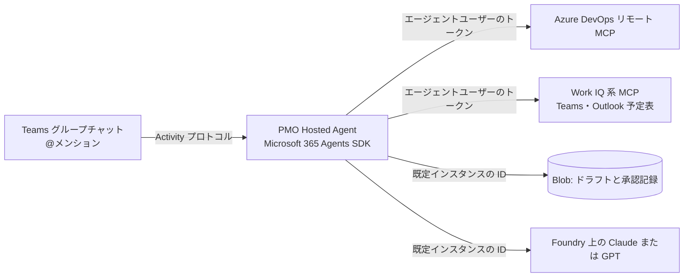

# PMO Agent（Autopilot版）

Microsoft Foundry Hosted Agent を **Agent 365 の Autopilot（グループ型）**として動かす MVP です。報告生成には Claude Agent SDK（既定）または OpenAI Python SDK と GPT を使います。デプロイ時に選択し、モデル間の自動切り替えは行いません。
プロジェクトごとに作成したインスタンスがチームの Teams チャットに参加し、@メンションされると、Azure DevOps と Microsoft 365（Work IQ 系 MCP）を**エージェント自身のユーザーアカウントの権限**で読み取り、根拠付きの報告ドラフトを作成します。

**このリポジトリは Azure リソースの作成・デプロイ・公開を自動実行しません。**
デプロイ用ツールは、既定で実行内容を表示するだけです（`--apply` を付けた場合だけ実行）。

## 構成



- **ブループリントとインスタンス**: このコードはブループリントです。チームはそこからインスタンスを作成（採用）します。
  インスタンスごとにエージェント ID と**エージェントユーザーアカウント**が作られ、ライセンスを 1 つ消費します。
- **アクセス範囲**: 各インスタンスが読めるのは、そのエージェントユーザーアカウントに与えた権限の範囲だけです（参加させた Azure DevOps プロジェクト、チーム、チャット、予定表など）。
  インスタンスの管理者が、チームごとに決めます。
- **Teams 連携**: Teams からのメッセージは Activity プロトコルで直接受信します（公式 Autopilot サンプルと同じ方式）。
  MCP 用のトークンは、Agents SDK の `AgenticUserAuthorization` でエージェントユーザーのものを取得します。
- **会話の状態**: ドラフトと承認記録は、会話ごとに Blob へ保存します。同時更新は ETag で検出します。
  Blob とモデルには、エージェントの**既定インスタンスの ID** でアクセスします。そのため、権限付与は 1 回で済みます。

## 使い方（チームのチャット）

| 送信内容 | 動作 |
| --- | --- |
| `@PMO Agent 今週の進捗と懸念をまとめて` | 情報を集め、`【PMO報告ドラフト vN】` を投稿。送信者を依頼者として記録 |
| `@PMO Agent 承認` | **依頼者本人だけ**が実行可能。最新ドラフトを承認し、`【承認記録】` を投稿 |
| `@PMO Agent 差戻し: 理由` | **依頼者本人だけ**が実行可能。元の依頼と理由を基に vN+1 を作成 |

- 送信者は、Bot Service が認証した Entra オブジェクト ID で判定します。表示名は判定に使いません。
- 依頼者以外の承認・差戻し、ドラフトのない状態での操作、二重の承認は拒否します。
- 承認時は、ドラフト版・ドラフト ID（本文の SHA-256 先頭16桁）・承認者 ID・UTC 日時を Blob に保存します。
  あわせて、トレースに `pmo.approval` イベントを記録します。
- 既定では @メンションされたときだけ応答します（`canRespondWithoutMention: false`）。

## 安全策

- Claude の組み込みツール（シェル、ファイル操作など）は無効です。外部 MCP 設定やローカル設定も読み込みません。
- MCP ツールは**許可リストにある読み取り用ツールだけ**を自動承認し、それ以外は拒否します。
  Claude では `PreToolUse` フック、GPT ではアプリ側の関数呼び出し処理が実行前に検査します。GPT には許可した関数の定義と結果を渡し、エージェントユーザーの Bearer トークンは渡しません。

  | サーバー | 既定で許可するツール（いずれも参照系） |
  | --- | --- |
  | `ado` | `wit_work_item`, `wit_query`, `wit_backlog` |
  | `teams` | `GetChat` / `GetChatMessage` / `ListChatMessages` / `ListChats`、`GetChannel` / `GetTeam` / `ListChannelMessages` / `ListChannelMessageReplies` / `ListChannels` |
  | `calendar` | `ListCalendarView` / `ListEvents` |

  メッセージ投稿、予定作成、Work Item 更新などの書き込み系は許可しません。
  ツール名が変わった場合、そのツールは使えなくなるだけで、意図しないツールが有効になることはありません。
- MCP サーバーの接続先は `agent365.svc.cloud.microsoft` と `workiq.svc.cloud.microsoft` に限定しています。
  いずれかのサーバーに接続できない場合は、報告を作成しません。
- 報告の各項目には根拠が必須です。Work Item ID は Azure DevOps の結果に、参照元は Microsoft 365 の結果に、実際に含まれる場合だけ保存・投稿します。
- 結果はグループ全員に見えるため、必要な範囲だけを記載するようモデルに指示しています。
  ただし、**本当の境界はエージェントユーザーアカウントの権限です。**
- `PMO_ADO_PROJECT` を設定すると、ツール入力の `project` も確認します（補助的なガード）。
- トレースへのメッセージ本文の記録は無効です（`OTEL_INSTRUMENTATION_GENAI_CAPTURE_MESSAGE_CONTENT=false`）。
  Foundry が注入する `APPLICATIONINSIGHTS_CONNECTION_STRING` があるとき、コンテナーの span（受信・`pmo.reply`・`pmo.generate`・モデル呼び出し・MCP ツール呼び出し）とログを Application Insights に送ります。記録するのはツール名・モデル名・トークン数などで、本文やツール引数は送りません。

## 前提条件

| 項目 | 内容 |
| --- | --- |
| プログラム・ライセンス | テナントの **Frontier プレビュー**登録と Agent 365 利用規約への同意、Microsoft 365 Copilot または Agent 365 ライセンス、インスタンス数分の Agent 365 Frontier ライセンス（プレビューは 25 席） |
| 管理者 | ブループリントを承認するグローバル管理者または AI 管理者 |
| Azure | Hosted Agent の提供リージョンにある Foundry プロジェクト、Claude または GPT のモデルデプロイ、ACR、Storage アカウント |
| Azure DevOps | Entra テナントに接続された組織。各インスタンスのエージェントユーザーを対象プロジェクトに追加し、アクセスレベルを割り当て |

## Azure 環境の新規構築（Bicep）

[infra/main.bicep](infra/main.bicep) は専用リソースグループに Foundry アカウントとプロジェクト、選択したモデル、Basic ACR、Storage と `pmo-conversations` を作ります。プロジェクトのマネージド ID にだけ ACR の `AcrPull` を付与します。Storage の匿名 Blob アクセス・共有キー、ACR の管理者アカウント、Foundry のローカル認証は無効です。**Private Endpoint は作成しません**。公開ネットワークを禁止する環境では、適用前に Hosted Agent とビルド端末からのプライベート接続・DNS を設計してください。

1. Azure CLI 2.53 以降、Bicep CLI、Docker を用意し、対象サブスクリプションにログインします。構築者にはリソースの作成とロール割り当ての権限が必要です。イメージを push する利用者には別途 ACR の `AcrPush`、エージェントの作成者にはプロジェクトの操作権限が必要です。
2. **以下のどちらか一方**を同じ Bash セッションで設定します。どちらも Hosted Agent と対象モデルの提供リージョン、Global Standard のバージョンとクォータを確認してください。

    **Claude 版**：[infra/main.bicepparam](infra/main.bicepparam) のモデル名・版・容量を確認し、[Marketplace の条件](https://learn.microsoft.com/azure/foundry/foundry-models/how-to/use-foundry-models-claude)に従って実際の組織情報を指定します。

    ```bash
    export CLAUDE_ORGANIZATION='<法人名>' CLAUDE_COUNTRY_CODE='<2文字の国コード>' CLAUDE_INDUSTRY='<業種>'
    PROVIDER=claude PARAMS=infra/main.bicepparam AGENT_NAME=pmo-agent DISPLAY_NAME='PMO Agent'
    INFERENCE_ROLE='Cognitive Services User'
    ```

    **GPT 版**：[infra/gpt.bicepparam](infra/gpt.bicepparam) を使います。Claude の購入・組織情報は不要です。モデルには Responses API、関数呼び出し、JSON モードが必要です（推論モデルは Chat Completions で関数呼び出しを拒否するため、Responses API を使います）。次は記入例であり、実際に提供されている名前・版に置き換えてください。カタログ名とは別に、このファイルでデプロイ名 `pmo-gpt` を指定しています。

    ```bash
    export PMO_GPT_CATALOG_MODEL=gpt-4.1 PMO_GPT_MODEL_VERSION=2025-04-14
    PROVIDER=gpt PARAMS=infra/gpt.bicepparam AGENT_NAME=pmo-agent-gpt DISPLAY_NAME='PMO Agent GPT'
    INFERENCE_ROLE='Cognitive Services OpenAI User'
    ```

    **共通：** 対象を確認して差分を表示します。両版を並べる場合は同じ RG・リージョンと異なるモデルデプロイ名を使い、以下の構築から公開までを各版について実行します。

    ```bash
    RG=rg-pmo-dev
    az account show --query '{subscription:name,id:id,tenant:tenantId}' -o table
    # 専用 RG がまだない場合だけ作成
    az group create --name "$RG" --location swedencentral
    az deployment group what-if -g "$RG" --parameters "$PARAMS"
    ```

3. 差分と課金対象を確認した後にだけ適用します。基盤だけを作る場合は `what-if` と `create` の両方で `--parameters "$PARAMS"` の後に `deployModel=false` を追加します。この場合 `modelDeploymentName` は空です。次節の `--model` には別途用意した同一アカウント内のデプロイ名を指定してください。

    ```bash
    az deployment group create -g "$RG" -n "pmo-infra-$PROVIDER" --parameters "$PARAMS"
    out() { az deployment group show -g "$RG" -n "pmo-infra-$PROVIDER" --query "properties.outputs.$1.value" -o tsv; }
    IMAGE=$(out image)
    ```

リソース名は RG の ID から生成するため、同じ RG への再適用は同じ環境を対象にします。Bicep の版によっては `modelProviderData` に型警告 `BCP037` が出ますが、[公式 Bicep サンプル](https://github.com/Azure-Samples/claude/blob/main/infra-bicep/infra/foundry.bicep)と同じプロバイダー情報を ARM に渡します。Bicep はエージェントの公開、管理者同意、ライセンス割り当ては行いません。

> **Storage の公開ネットワークアクセス：** Hosted Agent のコンテナーは、会話用 Blob に公開エンドポイント経由で接続します。Azure Policy（例：MCAPSGov の `StorageAccount_PublicNetwork_Modify`）が `publicNetworkAccess` を `Disabled` に書き換える環境では、Bicep の適用は成功しても、最初の依頼で Blob が `403 AuthorizationFailure` になります。組織の規定に従い、ポリシーの除外またはプライベート接続を用意してください。手順は「[手作業で行う設定](#手作業で行う設定)」を参照してください。

## エージェントのデプロイ手順

以下の手順は利用者が実行します。`pmo-autopilot` は、`--apply` なしでは送信内容を表示するだけです。

1. **イメージをビルドし、ACR へ push します。**

   ```bash
    az acr login --name "$(out acrName)"
    docker build --platform linux/amd64 -t "$IMAGE" .
    docker push "$IMAGE"
   ```

   プロジェクトのマネージド ID に、ACR の pull 権限が必要です。
2. **会話用 Blob を用意します。** Bicep を使った場合、非公開コンテナー `pmo-conversations` は作成済みです。手動構築の場合は同名のコンテナーを事前に作成してください。Azure では起動時に Blob にアクセスしないため、エージェントの作成後、最初の依頼を送る前に手順 4 の権限付与を行います。
3. **エージェントを作成します。**
   Activity プロトコル版を作成し、既定インスタンスの ID を設定した版をもう一度作成します。そのうえで、Bot Service 認証を有効化します。

   ```bash
   pmo-autopilot create --project-endpoint "$(out projectEndpoint)" \
    --name "$AGENT_NAME" --provider "$PROVIDER" --image "$IMAGE" --model "$(out modelDeploymentName)" \
     --ado-organization '<Azure DevOps 組織名>' --ado-project '<Azure DevOps プロジェクト名>' \
     --storage-account "$(out storageAccountName)"   # 確認後に --apply
   ```

   実行すると、`blueprint_client_id` と `runtime_client_id` が表示されます。
   `--ado-project` には Azure DevOps 上の**正確なプロジェクト名**を指定します。指定しないと、モデルが依頼文中の通称をそのまま使い、`TF200016`（プロジェクトが存在しない）になることがあります。
4. **既定インスタンスの ID に権限を付与します**（プロジェクトの Foundry User、会話用コンテナーの Storage Blob Data Contributor）。

   ```bash
   RUNTIME_CLIENT_ID='<create --apply が返した runtime_client_id>'
   pmo-autopilot grant --runtime-client-id "$RUNTIME_CLIENT_ID" \
     --project-resource-id "$(out projectResourceId)" \
     --storage-account-id "$(out storageAccountId)"   # 確認後に --apply
   ```

    Claude は親アカウントの `/anthropic`、GPT は `/openai/v1/` を使います。プロジェクトのロールは親に継承されないため、選択した版の実行 ID にだけ、上で設定した推論ロールをアカウントスコープで付与します（以下は実際に権限を変更します）。

   ```bash
   PRINCIPAL_ID=$(az ad sp show --id "$RUNTIME_CLIENT_ID" --query id -o tsv)
   az role assignment create --assignee-object-id "$PRINCIPAL_ID" --assignee-principal-type ServicePrincipal \
    --role "$INFERENCE_ROLE" --scope "$(out foundryAccountId)"
   ```
5. **Autopilot として公開します。**
   要求するアクセス許可は、Teams・予定表（`McpServers.Teams.All`, `McpServers.Calendar.All`）と Azure DevOps（`Ado.Mcp.Tools`）だけです。
   公開前に、テナントに **Azure DevOps MCP** のエンタープライズアプリがあることを確認します（「[手作業で行う設定](#手作業で行う設定)」の 1）。ないと、承認時に Azure DevOps への同意を付与できません。

   ```bash
   pmo-autopilot publish --project-endpoint "$(out projectEndpoint)" --name "$AGENT_NAME" \
     --display-name "$DISPLAY_NAME" --blueprint-client-id '<この版の create が返した blueprint_client_id>' \
     --developer '<組織名>' --website 'https://example.com' \
     --privacy-url 'https://example.com/privacy' --terms-url 'https://example.com/terms'   # 自社 URL に替え、確認後に --apply
   ```

6. **管理者が承認します。**
   [Microsoft 365 管理センター](https://admin.cloud.microsoft/?#/agents/all/requested)の Requests で承認します。
   採用できる人の範囲とポリシーを設定し、アクセス許可に管理者の同意を与えます。
   承認後、Azure DevOps MCP への同意と継承の設定がブループリントに入っていることを確認します（「[手作業で行う設定](#手作業で行う設定)」の 2）。
7. **チームがインスタンスを作成します。**
   Teams の **Apps → Agents for your team** から作成し、エージェントユーザーをチームのチャット、チャネル、Azure DevOps プロジェクトに追加します。

  GPT 版は `@PMO Agent GPT`（実際のインスタンス名）でメンションします。比較する場合は各版を個別に採用し、それぞれのエージェントユーザーに同じデモデータへの読み取り権限を付けてください。以下の原典照合・差戻し・承認を各版で確認します。

## 手作業で行う設定

次の設定は Bicep も `pmo-autopilot` も行いません。テナントや組織の統制に関わるため、影響を確認してから実施してください。

| # | 設定 | 実施者・必要な権限 | タイミング | 影響範囲 |
| --- | --- | --- | --- | --- |
| 1 | Azure DevOps MCP のエンタープライズアプリを作成 | アプリケーション管理者以上 | 公開前、テナントに 1 回 | テナント全体 |
| 2 | ブループリントに Azure DevOps MCP の同意と継承を設定 | アプリケーション管理者＋Agent ID 管理者 | 承認後、確認して不足していれば | このブループリントの全インスタンス |
| 3 | 会話用 Storage の公開ネットワークアクセス | Storage の共同作成者以上 | ポリシーで無効化される環境だけ | 対象の Storage アカウント |
| 4 | エージェントユーザーを Azure DevOps・Teams・予定表に参加させる | 各リソースの管理者 | インスタンス作成後 | そのインスタンスの読み取り範囲 |

### 1. Azure DevOps MCP のエンタープライズアプリ

テナントにアプリ（アプリ ID `2a72489c-aab2-4b65-b93a-a91edccf33b8`）がないと、Azure DevOps への同意を付与できず、トークン取得が `AADSTS65001` で失敗します。[公式の手順](https://learn.microsoft.com/azure/devops/mcp-server/remote-mcp-server-troubleshooting#cant-find-the-azure-devops-mcp-enterprise-application-in-the-tenant)で作成します。

```bash
az rest --method get --url "https://graph.microsoft.com/v1.0/servicePrincipals(appId='2a72489c-aab2-4b65-b93a-a91edccf33b8')"   # 404 なら未作成
az ad sp create --id 2a72489c-aab2-4b65-b93a-a91edccf33b8
```

### 2. ブループリントへの Azure DevOps MCP の同意と継承

承認後に、ブループリントのサービスプリンシパルへの同意と、インスタンスへの継承を確認します。必要なのは `Ado.Mcp.Tools`（接続）と `wit.read`（Work Item の読み取り）だけです。どちらかがなければ追加します。

```bash
BLUEPRINT='<blueprint_client_id>'
BP_SP=$(az ad sp show --id "$BLUEPRINT" --query id -o tsv)
BP_APP=$(az rest --method get --url "https://graph.microsoft.com/beta/applications(appId='$BLUEPRINT')?\$select=id" --query id -o tsv)
ADO_SP=$(az ad sp show --id 2a72489c-aab2-4b65-b93a-a91edccf33b8 --query id -o tsv)

# 確認：同意と継承
az rest --method get --url "https://graph.microsoft.com/v1.0/oauth2PermissionGrants?\$filter=clientId eq '$BP_SP'" \
  --query "value[?resourceId=='$ADO_SP'].scope"
az rest --method get --url "https://graph.microsoft.com/beta/applications/$BP_APP/microsoft.graph.agentIdentityBlueprint/inheritablePermissions" \
  --query "value[?resourceAppId=='2a72489c-aab2-4b65-b93a-a91edccf33b8'].inheritableScopes.scopes"

# 不足している場合だけ：全ユーザー対象の管理者同意と、インスタンスへの継承
az rest --method post --url https://graph.microsoft.com/v1.0/oauth2PermissionGrants --headers Content-Type=application/json \
  --body "{\"clientId\":\"$BP_SP\",\"consentType\":\"AllPrincipals\",\"resourceId\":\"$ADO_SP\",\"scope\":\"Ado.Mcp.Tools wit.read\"}"
az rest --method post --url "https://graph.microsoft.com/beta/applications/$BP_APP/microsoft.graph.agentIdentityBlueprint/inheritablePermissions" \
  --headers Content-Type=application/json \
  --body '{"resourceAppId":"2a72489c-aab2-4b65-b93a-a91edccf33b8","inheritableScopes":{"@odata.type":"microsoft.graph.enumeratedScopes","scopes":["Ado.Mcp.Tools","wit.read"]}}'
```

継承の設定には [Agent ID 管理者](https://learn.microsoft.com/graph/api/agentidentityblueprint-post-inheritablepermissions?view=graph-rest-beta)ロールが必要です。Teams・予定表（Agent Tools）の同意は、承認時に自動で付与されます。

### 3. 会話用 Storage の公開ネットワークアクセス

Azure Policy が `publicNetworkAccess` を `Disabled` に書き換える環境だけで必要です。次は MCAPSGov の例で、ポリシーが定める除外タグ `SecurityControl=Ignore` を付けてから有効にします。共有キー認証は無効のままで、Entra ID による認証が必要な状態は変わりません。

```bash
ST="$(out storageAccountName)"
az resource tag --is-incremental --tags SecurityControl=Ignore --ids "$(out storageAccountId)"
az storage account update -n "$ST" -g "$RG" --public-network-access Enabled
az storage account show -n "$ST" -g "$RG" --query '{pna:publicNetworkAccess,sharedKey:allowSharedKeyAccess}'
```

これは組織のセキュリティ統制からの除外です。本番では、組織の承認を得るか、プライベート接続を設計してください。デモ用に付けた場合は、終了後にタグを外します。外すと公開アクセスがポリシーで無効に戻り、エージェントは会話を保存できなくなります。

```bash
az tag update --resource-id "$(out storageAccountId)" --operation Delete --tags SecurityControl=Ignore
```

### 4. エージェントユーザーの参加

インスタンスが読めるのは、エージェントユーザーに与えた範囲だけです。

- **Azure DevOps：** 組織にアクセスレベル付きで追加し、対象プロジェクトの Readers に加えます。
- **Teams：** 依頼を受けるチャネルまたはチャットに参加させます。エージェントは、依頼を受けた場所（チャネルは team-id と channel-id、チャットは chat-id）を使って投稿を読みます。
- **予定表：** 参照させたい会議に招待します。

### 症状から原因を引く

ログはセッション単位です（`GET {project}/agents/{name}/sessions/{id}:logstream?api-version=v1&type=console`）。セッション一覧（`/endpoint/sessions`）は既定で古いものから返るため、新しいセッションは `order=desc` で探します。

| 症状（Teams の返信またはログ） | 主な原因 | 対処 |
| --- | --- | --- |
| 返信がない。ログに `activity_ingress … status=401` | ローカル用の JWT 検証が効いている（Foundry は入口で認証済みで、コンテナーに `Authorization` を渡さない） | `PMO_ENVIRONMENT=azure` で、Foundry 上で動いているか確認 |
| 「接続できませんでした」。ログに Blob の `AuthorizationFailure` | Storage の公開アクセスが無効 | 上記 3 |
| 「接続できませんでした」。ログに `AADSTS65001` | Azure DevOps MCP の同意がない | 上記 1・2 |
| Azure DevOps の結果が `TF200016` | プロジェクト名の誤り | `--ado-project` に正確な名前を指定 |
| 「Teams・予定表を参照できません」。ログの `mcp_tools enabled=` に Teams・予定表がない | 許可リストと実際のツール名が不一致 | `mcp_tools server=… offered=` の名前で `PMO_ALLOWED_TOOLS` を見直す |
| 返信は届くが、トレースに `agents.error`（`ActivityProtocolRequestFailed` / `HttpRequestException`）| 応答を返さないまま約 30 秒が経ち、ゲートウェイが接続を切った（返信を遅らせる処理を入れる前のイメージ） | 最新イメージで新しいバージョンを作成。ログの `Deferred reply failed` も確認 |
| 「根拠を確認できる報告を作成できませんでした」 | 報告の根拠がツールの結果と一致しない | ログの `report_rejected reason=` を確認 |

## デモの事前準備：顧客ポータルのリリース判定

前節の手順 7 までを完了し、ライセンスを割り当てたデモ用インスタンスを 1 体用意します。以下でプロジェクトや会議に招待するのは、その**エージェントユーザー**です。Foundry プロジェクトのマネージド ID や `runtime_client_id` は使いません。デモ用データは Bicep の作成対象外なので、以下の順に人が登録します。

1. **担当者と公開範囲を決めます。** PM 役は依頼・差戻し・承認を、開発担当者役は進捗の投稿を担当します。報告はチャット全員に届きますが、各参加者が元データを閲覧できるかまでは照合されません。実案件のインスタンスは流用せず、専用エージェントのアクセス先をデモ用のプロジェクト・チャット・予定表に限定し、全員に開示できる架空データだけを使います。

   管理者はデプロイ時に、ブループリントを採用できる人をデモ担当者に限定し、必要なアクセス許可に同意しておきます。Azure のロール割り当ても当日までに完了させます。
2. **Azure DevOps プロジェクトを用意します。** エージェント作成時に指定した組織（Microsoft 365 と同じ Entra テナントに接続済み）に、非公開プロジェクト `PMO-Demo` を作ります。人には Work Item の編集権限を、エージェントユーザーには対象 Work Item を閲覧できるアクセスレベルと読み取り権限を付与します。
3. **Azure Boards に次の 3 件を登録し、実際に採番された ID を控えます。** 状態名はプロジェクトで使用するプロセスに合わせます。

    | Work Item | 状態 | 担当者 |
    | --- | --- | --- |
    | ログイン機能の受入試験 | 完了 | 開発担当者 |
    | CSV 出力の文字化け修正 | 対応中 | 開発担当者 |
    | リリース判定資料の更新 | 未着手 | PM |

    ID を指定しないデモでは、この 3 件を返す共有クエリを用意し、エージェントユーザーで実行できることを確認して、クエリ名を控えます。

4. **Teams にグループチャット「顧客ポータル｜リリース準備」を作ります。** PM 役、開発担当者役、エージェントユーザーが参加した後、開発担当者役が次の文章を投稿します。`〈ID〉` は CSV 修正の実 ID に置き換えます。  
    投稿例：「#〈ID〉の再試験に使う匿名化サンプルが未着です。到着後に再試験するため、リリース判定は保留です。」この保留理由はチャットだけに書きます。
  5. **デモ週内に「顧客ポータル｜リリース判定会」を設定します。** PM 役が日時を決め、Outlook または Teams の予定表から開発担当者役とエージェントユーザーを招待します。招待本文だけに「判定項目：文字コード再試験（UTF-8 と Shift_JIS の比較）」と記載します。参照するのは予定表のイベントなので、会議の開催・録画・文字起こしは不要です。

## 当日のデモシナリオ：顧客ポータルのリリース判定

1. **管理者が Foundry と Agent 365 の権限の違いを示します。** 設定済みの内容を表示するだけで、実演中に権限は追加しません。

    - **Azure ポータル：** 対象リソースの「アクセス制御 (IAM)」で、プロジェクトのマネージド ID の `AcrPull` と、既定インスタンスの実行 ID の `Foundry User`（プロジェクト）、推論ロール（親アカウント：Claude は `Cognitive Services User`、GPT は `Cognitive Services OpenAI User`）、`Storage Blob Data Contributor`（会話用コンテナー）を示します。これらは Teams や Boards の閲覧権限ではありません。
    - **Microsoft 365 管理センター：** [ブループリントの承認](https://learn.microsoft.com/azure/foundry/agents/how-to/agent-365#approve-the-blueprint)で設定した採用範囲と、Teams・予定表・Azure DevOps に対する管理者同意を示します。**Agents → All agents → Registry** でデモ用インスタンスと所有者を確認します。元データを読むのは、このインスタンスのエージェントユーザーです。

2. **PM 役が Teams で報告を依頼します。** 「顧客ポータル｜リリース準備」チャットで、下記の ID を事前に控えた実 ID に置き換えて送ります。共有クエリを使う場合は、3 件の ID の代わりにクエリ名を指定します。

     `@PMO Agent PMO-Demo の #〈ID1〉、#〈ID2〉、#〈ID3〉の進捗、チャットで報告された判定保留の理由、次の判定会の日時と判定項目を、根拠付きでまとめて`

3. **最初のドラフトを 3 つの原典と照合します。** Boards の実 ID と状態が 3 件とも一致し、チャットだけに書いた「匿名化サンプルが未着」と、会議招待だけに書いた日時・比較対象の両方が読み取れることを確認します。会議名が出ただけでは合格にしません。受入試験の完了とリリース可否の未決定が区別されていない場合や、根拠が欠ける場合は承認せず、該当するデータの内容・閲覧権限を確認します。
4. **PM 役が差戻し、次版を承認します。** 同じ PM 役が同じチャットで `@PMO Agent 差戻し: 完了事項と判定待ちを分けてください` と送ります。次版の返信を待ち、内容とドラフト ID を確認してから `@PMO Agent 承認` と送ります。承認対象は処理時点の最新ドラフトなので、途中で別の依頼は送りません。承認されるのは報告書であり、リリースそのものではありません。

5. **承認の証跡と停止対象を示します。** 閲覧権限のある担当者が会話用 Blob の承認記録を開き、版・ドラフト ID・承認者 ID・UTC 日時を直前の承認操作と照合します。これは管理者によるエージェントの利用承認とは別の記録です。続いて管理者が Microsoft 365 管理センターの **Agents → All agents → 対象エージェント → Details → Instances** でデモ用インスタンスを選び、**Block** の場所を示します。通常は表示までとし、停止を実演する場合だけ、報告デモ終了後に所有者の了解を得てその 1 体をブロックします。[インスタンスの停止と再開](https://learn.microsoft.com/microsoft-agent-365/admin/manage-agent-instances#block-agent-instances)

**リハーサルの合格条件：** 3 つの原典と報告が一致し、承認記録の版とドラフト ID が差戻し後に PM が確認したものと一致すること。

本番へ移す前に、報告をチャットに再投稿してよい条件、Blob の保存期間と削除責任者、監査ログの保管先を決めてください。管理者が利用を承認したことは、元データの機密ラベルや DLP が Teams の返信や Blob の複製にも適用されたことの証明にはなりません。

## 設定値

| 環境変数 | 既定値 | 内容 |
| --- | --- | --- |
| `PMO_FOUNDRY_PROJECT_ENDPOINT` | 必須（Azure ではプラットフォームの `FOUNDRY_PROJECT_ENDPOINT` を使用） | Foundry プロジェクトのエンドポイント |
| `PMO_PROVIDER` | `claude` | `claude` または `gpt`。どちらもグループ型 Autopilot |
| `PMO_ANTHROPIC_MODEL` | Claude のとき必須 | Claude のデプロイ名 |
| `PMO_GPT_MODEL` | GPT のとき必須 | GPT のデプロイ名。カタログのモデル名とは別 |
| `PMO_ADO_ORGANIZATION` | 必須 | Azure DevOps 組織名 |
| `PMO_ADO_PROJECT` | なし（指定を推奨） | Azure DevOps の正確なプロジェクト名。モデルに伝え、ツール入力の `project` もこの名前に制限する。`create --ado-project` で設定 |
| `PMO_STORAGE_ACCOUNT_NAME` | Azure では必須 | 会話の状態を保存する Storage アカウント |
| `PMO_RUNTIME_CLIENT_ID` | `create` が設定 | モデルと Blob に使う既定インスタンスの client ID |
| `PMO_M365_SERVERS` | Teams・予定表 | Microsoft 365 系 MCP サーバー（JSON）。Work IQ MCP（統合版）は `workiq.svc.cloud.microsoft` で追加可能 |
| `PMO_ALLOWED_TOOLS` | 上表 | 許可する読み取りツール（JSON 配列、`<サーバー>__<ツール>`） |
| `PMO_GENERATION_TIMEOUT` | `240` | 生成のタイムアウト（秒） |

サーバーやツールを追加した場合は、`pmo-autopilot publish` で要求するアクセス許可（`PERMISSION_SCOPES`）も見直してください。

## ローカルでの確認とテスト

```bash
python3 -m venv .venv && .venv/bin/pip install -e '.[dev]'
.venv/bin/ruff check src tests && .venv/bin/ruff format --check src tests && .venv/bin/mypy src
.venv/bin/pytest -q -m 'not storage'
```

Blob の同時更新テストは、分離した Azurite を起動して接続文字列を指定した場合だけ実行されます。

```bash
docker run --rm -d -p 127.0.0.1:10000:10000 \
  -e 'AZURITE_ACCOUNTS=pmolocal:cG1vLWxvY2FsLWRldmVsb3BtZW50LW9ubHktdGVzdC1rZXk=' \
  mcr.microsoft.com/azure-storage/azurite:3.35.0 azurite-blob --blobHost 0.0.0.0
PMO_TEST_STORAGE_CONNECTION='DefaultEndpointsProtocol=http;AccountName=pmolocal;AccountKey=cG1vLWxvY2FsLWRldmVsb3BtZW50LW9ubHktdGVzdC1rZXk=;BlobEndpoint=http://127.0.0.1:10000/pmolocal;' \
  .venv/bin/pytest -q
```

サンプルのキーは **Azurite 専用の公開テスト値**です。本番の接続文字列は渡さないでください。

エージェントユーザーのトークンは、Autopilot インスタンスへの実際の Activity でしか取得できません。
そのため、ローカルや Agents Playground では Azure DevOps・Microsoft 365 に接続できず、接続エラーを返します。
テストでは Claude SDK のイベント、GPT の HTTP 応答、MCP セッション、トークン取得を模擬します。実際の推論やテナントの権限は検証しません。

## 制約・未検証事項

- GPT 版は、Frontier 環境での作成・公開・承認・採用と、Teams のチャネルからの依頼・差戻し・承認までを確認済みです（Azure DevOps、Teams チャネル、予定表の読み取りを含む）。Claude 版とグループチャットからの依頼は、実環境では未検証です。
- Teams・予定表の MCP の実際のツール名（`ListChannelMessages` など）は、Microsoft Learn の記載（`mcp_graph_chat_…` など）と異なります。既定の許可リストは実際の名前に合わせています。プレビュー中は名前が変わる可能性があるため、ログの `mcp_tools server=… offered=` で確認してください。
- Teams・予定表の MCP（アプリ別）は、Copilot Studio のドキュメントで「後方互換用」と記載されています。
  公式 Autopilot サンプルでは使われていますが、将来の変更に備えて、Work IQ MCP（統合版）への切り替えを設定で可能にしています。
  ただし、統合版が Autopilot のトークンに対応するかは確認できていません。
- Foundry 上では、依頼を受けたターンで MCP 用トークンだけを取得してすぐ 202 を返し、生成と投稿は会話を継続する別ターン（プロアクティブ送信）で行います。
  Foundry ゲートウェイは約 30 秒で Activity の HTTP 接続を切り、トレースに `ActivityProtocolRequestFailed` を記録するためです。ローカルでは従来どおり同期的に処理します。
  後続の処理は受信リクエストのトレースを引き継いだ `pmo.reply` span として記録するため、`invoke_agent` が先に終わっても投稿までを同じトレースで追えます（ゲートウェイが `traceparent` を渡さない場合は別トレースになり、`gen_ai.conversation.id` で突き合わせます。ログの `traceparent_present=` で確認できます）。
- 承認記録は Blob とトレースに保存します。改ざん防止された監査記録ではありません。保持期間・アクセス権・バックアップは運用で定めてください。
- 報告の正確性は保証されません。根拠の ID・参照元の存在は確認しますが、記述内容が正しいかは人が確認してください。
- 自動投稿・メール対応などの自発的な動作は対象外です。

## 主なファイル

| ファイル | 内容 |
| --- | --- |
| [src/pmoagent/host.py](src/pmoagent/host.py) | Activity 受信（Foundry 上では入口で認証済み、ローカルでは JWT 検証）、エージェントユーザーのトークン取得、メンション処理 |
| [src/pmoagent/bot.py](src/pmoagent/bot.py) | 依頼・承認・差戻しの処理、依頼者の照合 |
| [src/pmoagent/agent.py](src/pmoagent/agent.py) | Claude の実行、ツール制御、根拠の検証 |
| [src/pmoagent/store.py](src/pmoagent/store.py) | 会話の状態の Blob 保存（ETag による競合検出） |
| [src/pmoagent/report.py](src/pmoagent/report.py) | 報告のスキーマ、ドラフトの表示、コマンド判定 |
| [src/pmoagent/config.py](src/pmoagent/config.py) | 設定、MCP サーバー、既定の許可リスト |
| [src/pmoagent/autopilot.py](src/pmoagent/autopilot.py) | 作成・権限付与・公開ツール（既定は表示のみ） |

## 参考

- [Autopilot とは](https://learn.microsoft.com/azure/foundry/agents/concepts/autopilot-overview)
- [Autopilot のクイックスタート](https://learn.microsoft.com/azure/foundry/agents/how-to/agent-365)
- [公式 Autopilot サンプル（Python）](https://github.com/microsoft-foundry/foundry-samples/tree/main/samples/python/foundry-autopilot-agent)
- [Azure DevOps リモート MCP サーバー](https://learn.microsoft.com/azure/devops/mcp-server/remote-mcp-server)
- [Teams MCP ツール](https://learn.microsoft.com/microsoft-copilot-studio/mcp-teams-tools) / [予定表 MCP ツール](https://learn.microsoft.com/microsoft-copilot-studio/mcp-calendar-tools)
