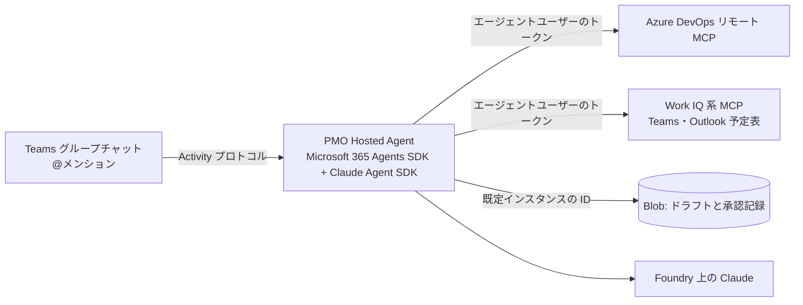

# PMO Agent（Autopilot版）

Claude Agent SDK で実装した Microsoft Foundry Hosted Agent を、**Agent 365 の Autopilot（グループ型）**として動かす MVP です。
プロジェクトごとに作成したインスタンスがチームの Teams チャットに参加し、@メンションされると、Azure DevOps と Microsoft 365（Work IQ 系 MCP）を**エージェント自身のユーザーアカウントの権限**で読み取り、根拠付きの報告ドラフトを作成します。

**このリポジトリは Azure リソースの作成・デプロイ・公開を自動実行しません。**
デプロイ用ツールは、既定で実行内容を表示するだけです（`--apply` を付けた場合だけ実行）。

## 構成



- **ブループリントとインスタンス**: このコードはブループリントです。チームはそこからインスタンスを作成（採用）します。
  インスタンスごとにエージェント ID と**エージェントユーザーアカウント**が作られ、ライセンスを 1 つ消費します。
- **アクセス範囲**: 各インスタンスが読めるのは、そのエージェントユーザーアカウントに与えた権限の範囲だけです（参加させた Azure DevOps プロジェクト、チーム、チャット、予定表など）。
  インスタンスの管理者が、チームごとに決めます。
- **Teams 連携**: Teams からのメッセージは Activity プロトコルで直接受信します（公式 Autopilot サンプルと同じ方式）。
  MCP 用のトークンは、Agents SDK の `AgenticUserAuthorization` でエージェントユーザーのものを取得します。
- **会話の状態**: ドラフトと承認記録は、会話ごとに Blob へ保存します。同時更新は ETag で検出します。
  Blob とモデルには、エージェントの**既定インスタンスの ID** でアクセスします。そのため、権限付与は 1 回で済みます。

## 使い方（チームのチャット）

| 送信内容 | 動作 |
| --- | --- |
| `@PMO Agent 今週の進捗と懸念をまとめて` | 情報を集め、`【PMO報告ドラフト vN】` を投稿。送信者を依頼者として記録 |
| `@PMO Agent 承認` | **依頼者本人だけ**が実行可能。最新ドラフトを承認し、`【承認記録】` を投稿 |
| `@PMO Agent 差戻し: 理由` | **依頼者本人だけ**が実行可能。元の依頼と理由を基に vN+1 を作成 |

- 送信者は、Bot Service が認証した Entra オブジェクト ID で判定します。表示名は判定に使いません。
- 依頼者以外の承認・差戻し、ドラフトのない状態での操作、二重の承認は拒否します。
- 承認時は、ドラフト版・ドラフト ID（本文の SHA-256 先頭16桁）・承認者 ID・UTC 日時を Blob に保存します。
  あわせて、トレースに `pmo.approval` イベントを記録します。
- 既定では @メンションされたときだけ応答します（`canRespondWithoutMention: false`）。

## 安全策

- Claude の組み込みツール（シェル、ファイル操作など）は無効です。外部 MCP 設定やローカル設定も読み込みません。
- MCP ツールは**許可リストにある読み取り用ツールだけ**を自動承認し、それ以外は拒否します。
  さらに `PreToolUse` フックで、許可リスト外のツールを明示的に拒否します。

  | サーバー | 既定で許可するツール（いずれも参照系） |
  | --- | --- |
  | `ado` | `wit_work_item`, `wit_query`, `wit_backlog` |
  | `teams` | `mcp_graph_chat_getChat` / `getChatMessage` / `listChatMessages` / `listChats`、`mcp_graph_teams_getChannel` / `getTeam` / `listChannelMessages` / `listChannels` |
  | `calendar` | `mcp_CalendarTools_graph_getEvent` / `listCalendarView` / `listEvents` |

  メッセージ投稿、予定作成、Work Item 更新などの書き込み系は許可しません。
  ツール名が変わった場合、そのツールは使えなくなるだけで、意図しないツールが有効になることはありません。
- MCP サーバーの接続先は `agent365.svc.cloud.microsoft` と `workiq.svc.cloud.microsoft` に限定しています。
  いずれかのサーバーに接続できない場合は、報告を作成しません。
- 報告の各項目には根拠が必須です。Work Item ID は Azure DevOps の結果に、参照元は Microsoft 365 の結果に、実際に含まれる場合だけ保存・投稿します。
- 結果はグループ全員に見えるため、必要な範囲だけを記載するようモデルに指示しています。
  ただし、**本当の境界はエージェントユーザーアカウントの権限です。**
- `PMO_ADO_PROJECT` を設定すると、ツール入力の `project` も確認します（補助的なガード）。
- トレースへのメッセージ本文の記録は無効です（`OTEL_INSTRUMENTATION_GENAI_CAPTURE_MESSAGE_CONTENT=false`）。

## 前提条件

| 項目 | 内容 |
| --- | --- |
| プログラム・ライセンス | テナントの **Frontier プレビュー**登録と Agent 365 利用規約への同意、Microsoft 365 Copilot または Agent 365 ライセンス、インスタンス数分の Agent 365 Frontier ライセンス（プレビューは 25 席） |
| 管理者 | ブループリントを承認するグローバル管理者または AI 管理者 |
| Azure | Hosted Agent の提供リージョンにある Foundry プロジェクト、Claude のモデルデプロイ、ACR、Storage アカウント |
| Azure DevOps | Entra テナントに接続された組織。各インスタンスのエージェントユーザーを対象プロジェクトに追加し、アクセスレベルを割り当て |

## Azure 環境の新規構築（Bicep）

[infra/main.bicep](infra/main.bicep) は専用リソースグループに Foundry アカウントとプロジェクト、同一アカウント内の Claude、Basic ACR、Storage と `pmo-conversations` を作ります。プロジェクトのマネージド ID にだけ ACR の `AcrPull` を付与します。Storage の匿名 Blob アクセス・共有キー、ACR の管理者アカウント、Foundry のローカル認証は無効です。**Private Endpoint は作成しません**。公開ネットワークを禁止する環境では、適用前に Hosted Agent とビルド端末からのプライベート接続・DNS を設計してください。

1. Azure CLI 2.53 以降、Bicep CLI、Docker を用意し、対象サブスクリプションにログインします。構築者にはリソースの作成とロール割り当ての権限が必要です。イメージを push する利用者には別途 ACR の `AcrPush`、エージェントの作成者にはプロジェクトの操作権限が必要です。
2. [infra/main.bicepparam](infra/main.bicepparam) のリージョン、Claude のモデル名・版・容量を確認します。例の値は提供を保証しません。**Hosted Agent と選択モデルの両方が利用可能なリージョン**を選び、[Claude の購入資格・Marketplace 条件](https://learn.microsoft.com/azure/foundry/foundry-models/how-to/use-foundry-models-claude)とクォータを確認してください。以下の組織情報には実際の値を設定します。Marketplace で規約への同意が必要な場合は、権限のある担当者が確認・同意してください。

    ```bash
    export CLAUDE_ORGANIZATION='<法人名>' CLAUDE_COUNTRY_CODE='<2文字の国コード>' CLAUDE_INDUSTRY='<業種>'
    RG=rg-pmo-dev
    az account show --query '{subscription:name,id:id,tenant:tenantId}' -o table
    # 専用 RG がまだない場合だけ作成
    az group create --name "$RG" --location swedencentral
    az deployment group what-if -g "$RG" --parameters infra/main.bicepparam
    ```

3. 差分と課金対象を確認した後にだけ適用します。次節は同じ Bash セッションで実行します。

    ```bash
    az deployment group create -g "$RG" -n pmo-infra --parameters infra/main.bicepparam
    out() { az deployment group show -g "$RG" -n pmo-infra --query "properties.outputs.$1.value" -o tsv; }
    IMAGE=$(out image)
    ```

リソース名は RG の ID から生成するため、同じ RG への再適用は同じ環境を対象にします。Bicep の版によっては `modelProviderData` に型警告 `BCP037` が出ますが、[公式 Bicep サンプル](https://github.com/Azure-Samples/claude/blob/main/infra-bicep/infra/foundry.bicep)と同じプロバイダー情報を ARM に渡します。Bicep はエージェントの公開、管理者同意、ライセンス割り当ては行いません。

## エージェントのデプロイ手順

以下の手順は利用者が実行します。`pmo-autopilot` は、`--apply` なしでは送信内容を表示するだけです。

1. **イメージをビルドし、ACR へ push します。**

   ```bash
    az acr login --name "$(out acrName)"
    docker build --platform linux/amd64 -t "$IMAGE" .
    docker push "$IMAGE"
   ```

   プロジェクトのマネージド ID に、ACR の pull 権限が必要です。
2. **会話用 Blob を用意します。** Bicep を使った場合、非公開コンテナー `pmo-conversations` は作成済みです。手動構築の場合は同名のコンテナーを事前に作成してください。Azure では起動時に Blob にアクセスしないため、エージェントの作成後、最初の依頼を送る前に手順 4 の権限付与を行います。
3. **エージェントを作成します。**
   Activity プロトコル版を作成し、既定インスタンスの ID を設定した版をもう一度作成します。そのうえで、Bot Service 認証を有効化します。

   ```bash
   pmo-autopilot create --project-endpoint "$(out projectEndpoint)" \
     --image "$IMAGE" --model "$(out modelDeploymentName)" \
     --ado-organization '<Azure DevOps 組織名>' --storage-account "$(out storageAccountName)"   # 確認後に --apply
   ```

   実行すると、`blueprint_client_id` と `runtime_client_id` が表示されます。
4. **既定インスタンスの ID に権限を付与します**（プロジェクトの Foundry User、会話用コンテナーの Storage Blob Data Contributor）。

   ```bash
   RUNTIME_CLIENT_ID='<create --apply が返した runtime_client_id>'
   pmo-autopilot grant --runtime-client-id "$RUNTIME_CLIENT_ID" \
     --project-resource-id "$(out projectResourceId)" \
     --storage-account-id "$(out storageAccountId)"   # 確認後に --apply
   ```

   Claude の推論先はプロジェクトではなく親アカウントの `/anthropic` です。プロジェクトのロールは親に継承されないため、この新規環境では実行 ID にアカウントスコープの推論権限も付与します（以下は実際に権限を変更します）。

   ```bash
   PRINCIPAL_ID=$(az ad sp show --id "$RUNTIME_CLIENT_ID" --query id -o tsv)
   az role assignment create --assignee-object-id "$PRINCIPAL_ID" --assignee-principal-type ServicePrincipal \
     --role 'Cognitive Services User' --scope "$(out foundryAccountId)"
   ```
5. **Autopilot として公開します。**
   要求するアクセス許可は、Teams・予定表（`McpServers.Teams.All`, `McpServers.Calendar.All`）と Azure DevOps（`Ado.Mcp.Tools`）だけです。

   ```bash
   pmo-autopilot publish --project-endpoint <プロジェクトのエンドポイント> \
     --blueprint-client-id <blueprint_client_id> --developer <組織名> \
     --website https://<自社サイト> --privacy-url https://<…>/privacy --terms-url https://<…>/terms   # 確認後に --apply
   ```

6. **管理者が承認します。**
   [Microsoft 365 管理センター](https://admin.cloud.microsoft/?#/agents/all/requested)の Requests で承認します。
   採用できる人の範囲とポリシーを設定し、アクセス許可に管理者の同意を与えます。
7. **チームがインスタンスを作成します。**
   Teams の **Apps → Agents for your team** から作成し、エージェントユーザーをチームのチャット、チャネル、Azure DevOps プロジェクトに追加します。

## デモの事前準備：顧客ポータルのリリース判定

前節の手順 7 までを完了し、ライセンスを割り当てたデモ用インスタンスを 1 体用意します。以下でプロジェクトや会議に招待するのは、その**エージェントユーザー**です。Foundry プロジェクトのマネージド ID や `runtime_client_id` は使いません。デモ用データは Bicep の作成対象外なので、以下の順に人が登録します。

1. **担当者と公開範囲を決めます。** PM 役は依頼・差戻し・承認を、開発担当者役は進捗の投稿を担当します。報告はチャット全員に届きますが、各参加者が元データを閲覧できるかまでは照合されません。実案件のインスタンスは流用せず、専用エージェントのアクセス先をデモ用のプロジェクト・チャット・予定表に限定し、全員に開示できる架空データだけを使います。

   管理者はデプロイ時に、ブループリントを採用できる人をデモ担当者に限定し、必要なアクセス許可に同意しておきます。Azure のロール割り当ても当日までに完了させます。
2. **Azure DevOps プロジェクトを用意します。** エージェント作成時に指定した組織（Microsoft 365 と同じ Entra テナントに接続済み）に、非公開プロジェクト `PMO-Demo` を作ります。人には Work Item の編集権限を、エージェントユーザーには対象 Work Item を閲覧できるアクセスレベルと読み取り権限を付与します。
3. **Azure Boards に次の 3 件を登録し、実際に採番された ID を控えます。** 状態名はプロジェクトで使用するプロセスに合わせます。

    | Work Item | 状態 | 担当者 |
    | --- | --- | --- |
    | ログイン機能の受入試験 | 完了 | 開発担当者 |
    | CSV 出力の文字化け修正 | 対応中 | 開発担当者 |
    | リリース判定資料の更新 | 未着手 | PM |

    ID を指定しないデモでは、この 3 件を返す共有クエリを用意し、エージェントユーザーで実行できることを確認して、クエリ名を控えます。

4. **Teams にグループチャット「顧客ポータル｜リリース準備」を作ります。** PM 役、開発担当者役、エージェントユーザーが参加した後、開発担当者役が次の文章を投稿します。`〈ID〉` は CSV 修正の実 ID に置き換えます。  
    投稿例：「#〈ID〉の再試験に使う匿名化サンプルが未着です。到着後に再試験するため、リリース判定は保留です。」この保留理由はチャットだけに書きます。
  5. **デモ週内に「顧客ポータル｜リリース判定会」を設定します。** PM 役が日時を決め、Outlook または Teams の予定表から開発担当者役とエージェントユーザーを招待します。招待本文だけに「判定項目：文字コード再試験（UTF-8 と Shift_JIS の比較）」と記載します。参照するのは予定表のイベントなので、会議の開催・録画・文字起こしは不要です。

## 当日のデモシナリオ：顧客ポータルのリリース判定

1. **管理者が Foundry と Agent 365 の権限の違いを示します。** 設定済みの内容を表示するだけで、実演中に権限は追加しません。

    - **Azure ポータル：** 対象リソースの「アクセス制御 (IAM)」で、プロジェクトのマネージド ID に付けた ACR の `AcrPull` と、既定インスタンスの実行 ID に付けたプロジェクトの `Foundry User`、親アカウントの `Cognitive Services User`、会話用コンテナーの `Storage Blob Data Contributor` を示します。これらは Teams や Boards の閲覧権限ではありません。
    - **Microsoft 365 管理センター：** [ブループリントの承認](https://learn.microsoft.com/azure/foundry/agents/how-to/agent-365#approve-the-blueprint)で設定した採用範囲と、Teams・予定表・Azure DevOps に対する管理者同意を示します。**Agents → All agents → Registry** でデモ用インスタンスと所有者を確認します。元データを読むのは、このインスタンスのエージェントユーザーです。

2. **PM 役が Teams で報告を依頼します。** 「顧客ポータル｜リリース準備」チャットで、下記の ID を事前に控えた実 ID に置き換えて送ります。共有クエリを使う場合は、3 件の ID の代わりにクエリ名を指定します。

     `@PMO Agent PMO-Demo の #〈ID1〉、#〈ID2〉、#〈ID3〉の進捗、チャットで報告された判定保留の理由、次の判定会の日時と判定項目を、根拠付きでまとめて`

3. **最初のドラフトを 3 つの原典と照合します。** Boards の実 ID と状態が 3 件とも一致し、チャットだけに書いた「匿名化サンプルが未着」と、会議招待だけに書いた日時・比較対象の両方が読み取れることを確認します。会議名が出ただけでは合格にしません。受入試験の完了とリリース可否の未決定が区別されていない場合や、根拠が欠ける場合は承認せず、該当するデータの内容・閲覧権限を確認します。
4. **PM 役が差戻し、次版を承認します。** 同じ PM 役が同じチャットで `@PMO Agent 差戻し: 完了事項と判定待ちを分けてください` と送ります。次版の返信を待ち、内容とドラフト ID を確認してから `@PMO Agent 承認` と送ります。承認対象は処理時点の最新ドラフトなので、途中で別の依頼は送りません。承認されるのは報告書であり、リリースそのものではありません。

5. **承認の証跡と停止対象を示します。** 閲覧権限のある担当者が会話用 Blob の承認記録を開き、版・ドラフト ID・承認者 ID・UTC 日時を直前の承認操作と照合します。これは管理者によるエージェントの利用承認とは別の記録です。続いて管理者が Microsoft 365 管理センターの **Agents → All agents → 対象エージェント → Details → Instances** でデモ用インスタンスを選び、**Block** の場所を示します。通常は表示までとし、停止を実演する場合だけ、報告デモ終了後に所有者の了解を得てその 1 体をブロックします。[インスタンスの停止と再開](https://learn.microsoft.com/microsoft-agent-365/admin/manage-agent-instances#block-agent-instances)

**リハーサルの合格条件：** 3 つの原典と報告が一致し、承認記録の版とドラフト ID が差戻し後に PM が確認したものと一致すること。

本番へ移す前に、報告をチャットに再投稿してよい条件、Blob の保存期間と削除責任者、監査ログの保管先を決めてください。管理者が利用を承認したことは、元データの機密ラベルや DLP が Teams の返信や Blob の複製にも適用されたことの証明にはなりません。

## 設定値

| 環境変数 | 既定値 | 内容 |
| --- | --- | --- |
| `PMO_FOUNDRY_PROJECT_ENDPOINT` | 必須（Azure ではプラットフォームの `FOUNDRY_PROJECT_ENDPOINT` を使用） | Foundry プロジェクトのエンドポイント |
| `PMO_ANTHROPIC_MODEL` | 必須 | Claude のデプロイ名 |
| `PMO_ADO_ORGANIZATION` | 必須 | Azure DevOps 組織名 |
| `PMO_ADO_PROJECT` | なし | 任意のプロジェクト制限 |
| `PMO_STORAGE_ACCOUNT_NAME` | Azure では必須 | 会話の状態を保存する Storage アカウント |
| `PMO_RUNTIME_CLIENT_ID` | `create` が設定 | モデルと Blob に使う既定インスタンスの client ID |
| `PMO_M365_SERVERS` | Teams・予定表 | Microsoft 365 系 MCP サーバー（JSON）。Work IQ MCP（統合版）は `workiq.svc.cloud.microsoft` で追加可能 |
| `PMO_ALLOWED_TOOLS` | 上表 | 許可する読み取りツール（JSON 配列、`<サーバー>__<ツール>`） |
| `PMO_GENERATION_TIMEOUT` | `240` | 生成のタイムアウト（秒） |

サーバーやツールを追加した場合は、`pmo-autopilot publish` で要求するアクセス許可（`PERMISSION_SCOPES`）も見直してください。

## ローカルでの確認とテスト

```bash
python3 -m venv .venv && .venv/bin/pip install -e '.[dev]'
.venv/bin/ruff check src tests && .venv/bin/ruff format --check src tests && .venv/bin/mypy src
.venv/bin/pytest -q -m 'not storage'
```

Blob の同時更新テストは、分離した Azurite を起動して接続文字列を指定した場合だけ実行されます。

```bash
docker run --rm -d -p 127.0.0.1:10000:10000 \
  -e 'AZURITE_ACCOUNTS=pmolocal:cG1vLWxvY2FsLWRldmVsb3BtZW50LW9ubHktdGVzdC1rZXk=' \
  mcr.microsoft.com/azure-storage/azurite:3.35.0 azurite-blob --blobHost 0.0.0.0
PMO_TEST_STORAGE_CONNECTION='DefaultEndpointsProtocol=http;AccountName=pmolocal;AccountKey=cG1vLWxvY2FsLWRldmVsb3BtZW50LW9ubHktdGVzdC1rZXk=;BlobEndpoint=http://127.0.0.1:10000/pmolocal;' \
  .venv/bin/pytest -q
```

サンプルのキーは **Azurite 専用の公開テスト値**です。本番の接続文字列は渡さないでください。

エージェントユーザーのトークンは、Autopilot インスタンスへの実際の Activity でしか取得できません。
そのため、ローカルや Agents Playground では Azure DevOps・Microsoft 365 に接続できず、接続エラーを返します。
テストでは、Claude・MCP・トークン取得をテストダブルに置き換えています。

## 制約・未検証事項

- Frontier 環境での作成・公開・承認・採用、エージェントユーザーのトークン取得、実際の MCP 呼び出しは検証していません。
- Teams・予定表の MCP（アプリ別）は、Copilot Studio のドキュメントで「後方互換用」と記載されています。
  公式 Autopilot サンプルでは使われていますが、将来の変更に備えて、Work IQ MCP（統合版）への切り替えを設定で可能にしています。
  ただし、統合版が Autopilot のトークンに対応するかは確認できていません。
- 生成は Teams の Activity 処理の中で同期的に行います（入力中表示を継続）。
  長時間の生成で Teams 側がタイムアウトしないかは、実環境で確認が必要です。
- 承認記録は Blob とトレースに保存します。改ざん防止された監査記録ではありません。保持期間・アクセス権・バックアップは運用で定めてください。
- 報告の正確性は保証されません。根拠の ID・参照元の存在は確認しますが、記述内容が正しいかは人が確認してください。
- 自動投稿・メール対応などの自発的な動作は対象外です。

## 主なファイル

| ファイル | 内容 |
| --- | --- |
| [src/pmoagent/host.py](src/pmoagent/host.py) | Activity 受信、JWT 検証、エージェントユーザーのトークン取得、メンション処理 |
| [src/pmoagent/bot.py](src/pmoagent/bot.py) | 依頼・承認・差戻しの処理、依頼者の照合 |
| [src/pmoagent/agent.py](src/pmoagent/agent.py) | Claude の実行、ツール制御、根拠の検証 |
| [src/pmoagent/store.py](src/pmoagent/store.py) | 会話の状態の Blob 保存（ETag による競合検出） |
| [src/pmoagent/report.py](src/pmoagent/report.py) | 報告のスキーマ、ドラフトの表示、コマンド判定 |
| [src/pmoagent/config.py](src/pmoagent/config.py) | 設定、MCP サーバー、既定の許可リスト |
| [src/pmoagent/autopilot.py](src/pmoagent/autopilot.py) | 作成・権限付与・公開ツール（既定は表示のみ） |

## 参考

- [Autopilot とは](https://learn.microsoft.com/azure/foundry/agents/concepts/autopilot-overview)
- [Autopilot のクイックスタート](https://learn.microsoft.com/azure/foundry/agents/how-to/agent-365)
- [公式 Autopilot サンプル（Python）](https://github.com/microsoft-foundry/foundry-samples/tree/main/samples/python/foundry-autopilot-agent)
- [Azure DevOps リモート MCP サーバー](https://learn.microsoft.com/azure/devops/mcp-server/remote-mcp-server)
- [Teams MCP ツール](https://learn.microsoft.com/microsoft-copilot-studio/mcp-teams-tools) / [予定表 MCP ツール](https://learn.microsoft.com/microsoft-copilot-studio/mcp-calendar-tools)
